# Course Materials RAG

An intelligent **Retrieval-Augmented Generation (RAG)** system designed to make course materials searchable and queryable using AI. This application enables students and educators to interact with PDF documents, text files, and YouTube video transcripts through natural language questions, powered by advanced semantic search and large language models.

## 🎯 Overview

Course Materials RAG transforms static educational content into an interactive, AI-powered knowledge base. The system uses state-of-the-art embedding models to understand content semantically, stores vectors in a FAISS index for fast similarity search, and leverages Groq's LLM to generate contextual, accurate answers based on retrieved course materials.

## 🏗️ Architecture

### RAG Pipeline

The system implements a sophisticated RAG architecture with the following components:

```mermaid
flowchart TB
    subgraph Input["📥 DOCUMENT INGESTION"]
        PDF["📄 PDF Files<br/><small>PyPDF Loader</small>"]
        TXT["📝 Text Files<br/><small>TextLoader</small>"]
        YT["🎥 YouTube Videos<br/><small>yt-dlp Transcripts</small>"]
    end

    subgraph Processing["⚙️ DOCUMENT PROCESSING"]
        Split["✂️ Text Splitting<br/><small>RecursiveCharacterTextSplitter<br/>800 chars | 150 overlap</small>"]
        Meta["🏷️ Metadata Enrichment<br/><small>course_id, title, type, source</small>"]
        Dedup["🔄 Chunk Deduplication"]
    end

    subgraph Embedding["🧠 VECTOR EMBEDDING"]
        Model["🤖 Embedding Model<br/><small>paraphrase-multilingual-mpnet-base-v2</small>"]
        Features["✨ Features<br/><small>• 768-dimensional vectors<br/>• Multilingual (50+ languages)<br/>• GPU acceleration (CUDA)</small>"]
    end

    subgraph Storage["💾 VECTOR STORAGE"]
        FAISS["🗄️ FAISS Index<br/><small>• Fast similarity search<br/>• Course-based filtering<br/>• Persistent on disk</small>"]
    end

    subgraph Query["🔍 QUERY PROCESSING"]
        QEmbed["📊 Query Embedding"]
        Hybrid["🎯 Hybrid Retrieval<br/><small>1. Semantic similarity (k×2)<br/>2. MMR for diversity<br/>3. Course-aware filtering</small>"]
        TopK["📋 Top-K Selection"]
    end

    subgraph Context["📚 CONTEXT AUGMENTATION"]
        Combine["🔗 Combine Chunks"]
        Format["📝 Format Context<br/><small>Add titles & sources</small>"]
        Structure["🏗️ Build LLM Input"]
    end

    subgraph Generation["✨ ANSWER GENERATION"]
        LLM["🚀 Groq LLM<br/><small>Llama 3.3 70B Versatile</small>"]
        Prompt["💬 System Prompt<br/><small>Educational assistant context</small>"]
        Cite["📖 Source Citations<br/><small>Markdown + LaTeX support</small>"]
    end

    subgraph Response["📤 RESPONSE DELIVERY"]
        Answer["✅ Formatted Answer"]
        Metrics["📊 Performance Metrics<br/><small>Processing time, chunks used</small>"]
        UI["💻 Interactive Chat UI<br/><small>React Frontend</small>"]
    end

    PDF --> Split
    TXT --> Split
    YT --> Split
    
    Split --> Meta
    Meta --> Dedup
    
    Dedup --> Model
    Model --> Features
    Features --> FAISS
    
    FAISS --> QEmbed
    QEmbed --> Hybrid
    Hybrid --> TopK
    
    TopK --> Combine
    Combine --> Format
    Format --> Structure
    
    Structure --> Prompt
    Prompt --> LLM
    LLM --> Cite
    
    Cite --> Answer
    Answer --> Metrics
    Metrics --> UI

    style Input fill:#e3f2fd,stroke:#1976d2,stroke-width:2px
    style Processing fill:#fff3e0,stroke:#f57c00,stroke-width:2px
    style Embedding fill:#f3e5f5,stroke:#7b1fa2,stroke-width:2px
    style Storage fill:#e8f5e9,stroke:#388e3c,stroke-width:2px
    style Query fill:#fff9c4,stroke:#f9a825,stroke-width:2px
    style Context fill:#fce4ec,stroke:#c2185b,stroke-width:2px
    style Generation fill:#e0f2f1,stroke:#00897b,stroke-width:2px
    style Response fill:#f1f8e9,stroke:#689f38,stroke-width:2px
```



### Key Architectural Features

#### 1. **Hybrid Retrieval Strategy**
The `HybridRetriever` class implements a sophisticated two-stage retrieval:
- **Semantic Search**: Uses cosine similarity to find top-k semantically similar chunks
- **Max Marginal Relevance (MMR)**: Ensures diversity in retrieved documents to avoid redundant information
- **Smart Filtering**: Course-aware filtering with automatic fallback to global search if no matches found

#### 2. **Multilingual Support**
- Uses `paraphrase-multilingual-mpnet-base-v2` embedding model
- Supports 50+ languages including English, French, Spanish, etc.
- Maintains semantic meaning across languages

#### 3. **Intelligent Chunking**
- **Chunk Size**: 800 characters (optimal for context length)
- **Overlap**: 150 characters (ensures continuity across boundaries)
- **Smart Separators**: Prioritizes natural breaks (paragraphs → sentences → words)

#### 4. **Course Management System**
- Multi-course support with isolated contexts
- Course metadata tracking (name, description, category, materials)
- Material organization by type (PDF, video, text)

## ✨ Features

### Core Capabilities

- **📚 Multi-Format Document Support**
  - PDF documents (lecture notes, textbooks, slides)
  - Text files (.txt, .md)
  - YouTube video transcripts (automatic extraction)

- **🔍 Advanced Semantic Search**
  - Understands intent, not just keywords
  - Multilingual query support
  - Course-scoped or global search

- **💬 Interactive Q&A Interface**
  - Natural language questions
  - Chat-like conversation history
  - Source citations for every answer
  - Processing time and chunk metrics

- **🎓 Course Management**
  - Create and organize multiple courses
  - Upload materials via web interface
  - Add YouTube videos by URL
  - Delete courses and materials

- **🚀 Fast Vector Search**
  - FAISS index for sub-second retrieval
  - GPU acceleration support
  - Persistent storage for quick startup

- **📊 System Statistics**
  - Course and material counts
  - Database size tracking
  - Material type distribution
  - Health monitoring

### User Interface Features

- **Modern React Frontend**
  - Responsive design with Tailwind CSS
  - Real-time status indicators
  - Drag-and-drop file upload
  - Markdown and LaTeX rendering support

- **API-First Architecture**
  - RESTful FastAPI backend
  - OpenAPI/Swagger documentation
  - CORS enabled for frontend integration
  - Comprehensive error handling

## 🛠️ Technology Stack

### Backend
- **FastAPI** - Modern, fast web framework for building APIs
- **LangChain** - Framework for developing LLM applications
- **FAISS** - Facebook AI Similarity Search for vector storage
- **Groq** - Ultra-fast LLM inference (Llama 3.3 70B)
- **Sentence Transformers** - Multilingual embedding models
- **PyTorch** - Deep learning framework (for embeddings)
- **yt-dlp** - YouTube content extraction

### Frontend
- **React 19** - UI library
- **TypeScript** - Type-safe JavaScript
- **Vite** - Fast build tool and dev server
- **Tailwind CSS** - Utility-first CSS framework
- **React Markdown** - Markdown rendering with LaTeX support (KaTeX)

### AI/ML Models
- **Embedding Model**: `paraphrase-multilingual-mpnet-base-v2` (768 dimensions)
- **LLM**: Groq Llama 3.3 70B Versatile
- **Vector Database**: FAISS (Facebook AI Similarity Search)

## 📦 Installation

### Prerequisites

- Python 3.8+
- Node.js 18+ and npm
- CUDA-capable GPU (optional, for faster embeddings)

### Backend Setup

1. **Navigate to backend directory:**
   ```bash
   cd Rag-Backend
   ```

2. **Create virtual environment:**
   ```bash
   python -m venv venv
   source venv/bin/activate  # On Windows: venv\Scripts\activate
   ```

3. **Install dependencies:**
   ```bash
   pip install -r requirements.txt
   ```

4. **Set up environment variables:**
   Create a `.env` file in the `Rag-Backend` directory:
   ```env
   GROQ_API_KEY=your_groq_api_key_here
   ```

   Get your Groq API key from [console.groq.com](https://console.groq.com)

5. **Run the API server:**
   ```bash
   uvicorn api:app --reload --host 0.0.0.0 --port 8000
   ```

   The API will be available at `http://localhost:8000`
   API documentation: `http://localhost:8000/docs`

### Frontend Setup

1. **Navigate to client directory:**
   ```bash
   cd client
   ```

2. **Install dependencies:**
   ```bash
   npm install
   ```

3. **Start development server:**
   ```bash
   npm run dev
   ```

   The frontend will be available at `http://localhost:5173`

## 🚀 Usage

### Quick Start

1. **Start both servers** (backend on port 8000, frontend on port 5173)

2. **Create a course:**
   - Navigate to the "Create Course" tab
   - Enter course name, description, and category
   - Click "Create Course"

3. **Add materials:**
   - Select your course from the sidebar
   - Go to "Add Materials" tab
   - Upload PDF/text files or add YouTube video URLs
   - Click "Rebuild Database" to index the materials

4. **Query your materials:**
   - Go to "Query" tab
   - Select a course (optional, for course-specific queries)
   - Ask questions in natural language
   - View answers with sources and metrics

### API Endpoints

#### Health & Status
- `GET /` - Health check and system status
- `GET /stats` - System statistics

#### Course Management
- `POST /courses` - Create a new course
- `GET /courses` - List all courses
- `GET /courses/{course_id}` - Get course details
- `DELETE /courses/{course_id}` - Delete a course

#### Material Management
- `POST /courses/{course_id}/materials/upload` - Upload PDF/text file
- `POST /courses/{course_id}/materials/youtube` - Add YouTube video

#### RAG Operations
- `POST /query` - Query course materials
  ```json
  {
    "query": "What is machine learning?",
    "course_id": "machine_learning_fundamentals",
    "max_chunks": 15,
    "stream": false
  }
  ```
- `POST /rebuild` - Rebuild vector database from all materials

### Example Queries

- "Explain the concept of neural networks"
- "What are the main topics covered in this course?"
- "Summarize the key points from the lecture on gradient descent"
- "What is the formula for calculating entropy?"

## 📁 Project Structure

```
Course-Materials-RAG/
├── Rag-Backend/           # Backend API server
│   ├── api.py            # FastAPI application with endpoints
│   ├── rag_app.py        # Standalone RAG CLI application
│   ├── requirements.txt  # Python dependencies
│   ├── courses/          # Uploaded course materials
│   ├── faiss_course_index/  # FAISS vector database
│   └── course_metadata.json  # Course metadata storage
│
├── client/                # Frontend React application
│   ├── src/
│   │   ├── App.tsx       # Main application component
│   │   └── ...
│   ├── package.json      # Node.js dependencies
│   └── ...
│
└── README.md             # This file
```

## 🔧 Configuration

### Embedding Model
The embedding model can be changed in `api.py`:
```python
EMBEDDING_MODEL = "sentence-transformers/paraphrase-multilingual-mpnet-base-v2"
```

### Chunking Parameters
Adjust chunk size and overlap in `api.py`:
```python
text_splitter = RecursiveCharacterTextSplitter(
    chunk_size=800,      # Characters per chunk
    chunk_overlap=150,   # Overlap between chunks
    separators=["\n\n", "\n", ". ", "! ", "? ", ", ", " ", ""]
)
```

### LLM Configuration
Modify LLM settings in `api.py`:
```python
llm = ChatGroq(
    temperature=0,              # Lower = more deterministic
    model_name="llama-3.3-70b-versatile",
    max_tokens=2048
)
```

## 🎓 RAG System Deep Dive

### Why RAG?

Retrieval-Augmented Generation combines the best of both worlds:
- **Retrieval**: Finds relevant information from your course materials
- **Generation**: Produces coherent, contextual answers using an LLM

This approach ensures:
- ✅ Answers are grounded in actual course content
- ✅ No hallucination from LLM's training data
- ✅ Source attribution and traceability
- ✅ Up-to-date information (your materials)

### Retrieval Strategy

The hybrid retrieval approach addresses common RAG challenges:

1. **Semantic Similarity**: Finds documents that mean the same thing, even with different wording
2. **Diversity (MMR)**: Avoids retrieving redundant chunks from the same document
3. **Course Filtering**: Searches within specific courses when context is known
4. **Fallback Logic**: Expands search if course filter yields no results

### Performance Optimizations

- **Vector Indexing**: FAISS provides fast approximate nearest neighbor search
- **Chunk Overlap**: Maintains context across chunk boundaries
- **Batch Processing**: Efficient embedding generation for multiple documents
- **GPU Acceleration**: Speeds up embedding computation when available

## 🐛 Troubleshooting

### Common Issues

1. **"Database not loaded" error**
   - Solution: Run `POST /rebuild` after adding materials

2. **"LLM not connected" error**
   - Check `GROQ_API_KEY` environment variable
   - Verify API key is valid at console.groq.com

3. **YouTube videos not loading**
   - Video must have captions/subtitles available
   - Check video is not private or restricted
   - Try different YouTube URL formats

4. **Slow embedding generation**
   - Install CUDA-enabled PyTorch for GPU acceleration
   - Reduce chunk size if memory constrained

## 📝 License

This project is open source. Feel free to use, modify, and distribute.

## 🤝 Contributing

Contributions are welcome! Please feel free to submit a Pull Request.

## 🙏 Acknowledgments

- **LangChain** for the RAG framework
- **Facebook AI** for FAISS vector search
- **Groq** for fast LLM inference
- **Hugging Face** for multilingual embedding models

---

Built with ❤️ for educators and students worldwide.
